# DATABASE RELATIONSHIP SPECIFICATION & ER DIAGRAM
## India Unified School ERP Platform (PostgreSQL + Prisma ORM)

---

### 1. High-Level Entity-Relationship (ER) Overview

```mermaid
erDiagram
    INSTITUTION_GROUP ||--o{ INSTITUTIONS : "owns/operates"
    INSTITUTIONS ||--o{ CAMPUSES : "has"
    INSTITUTIONS ||--o{ ACADEMIC_YEARS : "schedules"
    INSTITUTIONS ||--o{ BOARD_CONFIGURATIONS : "configures"
    INSTITUTIONS ||--o{ ID_SEQUENCES : "tracks"
    INSTITUTIONS ||--o{ USERS : "authenticates"
    INSTITUTIONS ||--o{ AUDIT_LOGS : "logs"

    INSTITUTIONS ||--o{ CLASSES : "offers"
    CLASSES ||--o{ SECTIONS : "contains"
    CLASSES ||--o{ CLASS_SUBJECTS : "teaches"
    SUBJECTS ||--o{ CLASS_SUBJECTS : "mapped_in"
    CLASS_SUBJECTS ||--o{ SYLLABUS : "follows"

    INSTITUTIONS ||--o{ STUDENTS : "enrolls"
    STUDENTS ||--o{ STUDENT_ENROLLMENTS : "attends"
    SECTIONS ||--o{ STUDENT_ENROLLMENTS : "groups"
    ACADEMIC_YEARS ||--o{ STUDENT_ENROLLMENTS : "valid_for"
    STUDENTS ||--o{ STUDENT_GUARDIANS : "cared_by"
    STUDENTS ||--o{ STUDENT_DOCUMENTS : "stores"
    STUDENTS ||--o{ STUDENT_TRANSFERS : "transfers"

    INSTITUTIONS ||--o{ TEACHERS : "employs"
    TEACHERS ||--o{ TEACHER_ASSIGNMENTS : "assigned_to"
    SECTIONS ||--o{ TEACHER_ASSIGNMENTS : "allocated"
    SUBJECTS ||--o{ TEACHER_ASSIGNMENTS : "handles"
    TEACHERS ||--o{ LESSON_PLANS : "creates"
    TEACHERS ||--o{ EMPLOYEE_LEAVES : "applies"

    SECTIONS ||--o{ TIMETABLES : "scheduled_in"
    TEACHERS ||--o{ TIMETABLES : "conducts"
    TIMETABLES ||--o{ TEACHER_SUBSTITUTIONS : "covered_by"

    SECTIONS ||--o{ STUDENT_ATTENDANCE : "marked_in"
    STUDENTS ||--o{ STUDENT_ATTENDANCE : "records"
    TEACHERS ||--o{ TEACHER_ATTENDANCE : "records"

    INSTITUTIONS ||--o{ EXAMINATIONS : "administers"
    EXAMINATIONS ||--o{ EXAM_SUBJECTS : "includes"
    EXAM_SUBJECTS ||--o{ ASSESSMENT_COMPONENTS : "breaks_down"
    STUDENTS ||--o{ MARKS : "scores"
    ASSESSMENT_COMPONENTS ||--o{ MARKS : "graded_in"
    STUDENTS ||--o{ REPORT_CARDS : "receives"

    INSTITUTIONS ||--o{ FEE_STRUCTURES : "defines"
    STUDENTS ||--o{ STUDENT_FEES : "billed"
    STUDENT_FEES ||--o{ FEE_PAYMENTS : "settled_with"
    FEE_PAYMENTS ||--o{ RECEIPTS : "issues"

    INSTITUTIONS ||--o{ ANNOUNCEMENTS : "publishes"
    INSTITUTIONS ||--o{ LIBRARY_BOOKS : "catalogs"
    LIBRARY_BOOKS ||--o{ LIBRARY_TRANSACTIONS : "issued_in"
    INSTITUTIONS ||--o{ TRANSPORT_ROUTES : "operates"
    INSTITUTIONS ||--o{ CERTIFICATES : "generates"
```

---

### 2. Core Relational Group Definitions

#### Group 1: Platform & Multi-Tenancy
1. **`platform_settings`**: Global SaaS flags, default tax settings, platform name, contact email.
2. **`platform_users`**: Super Administrators with multi-tenant governance rights.
3. **`institution_groups`**: Umbrella educational societies/trusts (e.g. *Delhi Public School Society*).
4. **`institutions`**: Tenant root entity with `tenantId`, affiliation number, state, district, logo, and active status.
5. **`campuses`**: Physical branches under an institution (e.g. Main Campus, KG Wing).
6. **`school_boards`**: Master board definitions (CBSE, ICSE, Karnataka State Board, Maharashtra, etc.).
7. **`board_configurations`**: Per-institution, per-academic-year custom grading rules, language schemes, and passing criteria in structured JSONB.
8. **`academic_years`**: Active and historical academic sessions (e.g. `2025-2026`, `2026-2027`).
9. **`id_sequences`**: Sequence generator counters guaranteeing atomic, collision-free human-readable IDs (`INS-IND-...`, `STU-...`).

#### Group 2: Identity, Roles & Permissions
10. **`users`**: Base authentication record (UUID, email, phone, hashed password, portal role, status).
11. **`roles`**: Standard role templates (`DIRECTOR`, `SCHOOL_ADMIN`, `TEACHER`, `STUDENT`, `ACCOUNTANT`, `LIBRARIAN`).
12. **`permissions`**: Granular resource permissions (`STUDENT_CREATE`, `MARKS_PUBLISH`, `FEE_COLLECT`, etc.).
13. **`user_memberships`**: Maps users to institutions and specific campuses with authorization context.
14. **`audit_logs`**: Immutable security trail recording actor, action, tenant, entity, diff, and IP.
15. **`login_sessions`**: Active JWT refresh tokens, device user-agents, IP addresses, and expiry.

#### Group 3: Students & Admissions
16. **`students`**: Person record with unique human-readable ID (`STU-INS000001-000042`), DOB, blood group, gender, nationality, medical notes.
17. **`student_admissions`**: Admission CRM record tracking online enquiries, submitted forms, document verifications, entrance status, and enrollment approvals.
18. **`student_enrollments`**: Academic link between student, academic year, class, section, and roll number.
19. **`student_guardians`**: Father, mother, or guardian contact info, occupation, annual income, emergency phone.
20. **`student_documents`**: Uploaded birth certificates, transfer certificates, previous mark sheets, medical fitness certificates with verification flags.
21. **`student_transfers`**: Inter-school or outgoing transfer records with TC numbers, reason, and source/destination institution metadata.
22. **`student_promotions`**: Historic record of academic promotions from one grade to the next.

#### Group 4: Teachers, Staff & HR
23. **`teachers`**: Teacher profile with human ID (`TCH-...`), qualification, specialization, joining date, biometric ID.
24. **`staff`**: Non-teaching administrative, transport, security, and facility staff.
25. **`departments`**: Academic and administrative departments (Science, Mathematics, Humanities, Accounts, Sports).
26. **`teacher_assignments`**: Mappings of teachers to specific class sections and subjects (Class Teacher vs Subject Teacher).
27. **`employee_leaves`**: Leave applications, approvals, leave balances (Casual, Medical, Earned).
28. **`payroll`**: Monthly compensation records (Basic, HRA, DA, PF, Professional Tax, Net Pay, Payslips).

#### Group 5: Academics & Timetable
29. **`classes`**: Grade levels (Pre-KG, Nursery, LKG, UKG, Class 1 to Class 12).
30. **`sections`**: Divisions per class (Section A, B, C, Rose, Lotus) with campus association.
31. **`subjects`**: Master subject list (English, Mathematics, Physics, Kannada, Sanskrit, etc.) with code and board classification.
32. **`class_subjects`**: Links subjects to classes with theory/practical weightage.
33. **`syllabus`**: Chapter-wise syllabus breakdowns with learning objectives and estimated periods.
34. **`lesson_plans`**: Teacher daily and weekly lesson preparation entries.
35. **`academic_calendars`**: Institutional events, exams, working days, and public holidays.
36. **`timetables`**: Period-by-period class schedules mapped by day of week, time slot, subject, room, and teacher.
37. **`teacher_substitutions`**: Substitution allocation records for absent teachers.

#### Group 6: Attendance Engine
38. **`student_attendance`**: Daily or period-level student attendance status (PRESENT, ABSENT, LATE, HALF_DAY, EXCUSED).
39. **`teacher_attendance`**: Staff biometric/punch/manual check-in, check-out, and status.
40. **`attendance_devices`**: Registered RFID, biometric, or mobile QR scanning endpoints.

#### Group 7: Examination & Report Cards
41. **`examinations`**: Assessment events (Periodic Assessment 1, Mid-Term, Pre-Board, Annual Examination).
42. **`exam_schedules`**: Exam dates, timings, rooms, and invigilator assignments.
43. **`exam_subjects`**: Subjects included in an examination with maximum and passing marks.
44. **`assessment_components`**: Sub-components (e.g. Theory 80, Practical 20, or Internal Assessment breakdown).
45. **`marks`**: Individual student scored marks per component, entered and locked.
46. **`grades`**: Grade thresholds (e.g. 91-100 = A1).
47. **`report_cards`**: Compiled report card snapshot with attendance summary, co-scholastic remarks, and digital signature hash.

#### Group 8: Finance, Fees & Payments
48. **`fee_categories`**: Tuition, Admission, Term, Transport, Laboratory, Library, Hostel, Sports.
49. **`fee_structures`**: Class/stream fee slabs configured by term, month, or annual cadence.
50. **`student_fees`**: Ledger of fees allocated to an enrolled student.
51. **`fee_concessions`**: Merit scholarships, sibling discounts, staff ward concessions.
52. **`fee_payments`**: Payment transactions (Cash, Cheque, DD, Online Gateway, UPI).
53. **`receipts`**: Numbered financial receipts with GST breakdown where applicable.
54. **`expenses`**: School operational expenditures categorized by head with approval workflow.

#### Group 9: Campus Operations, Operations & Documents
55. **`library_books`**: Catalog with ISBN, title, author, barcode, shelf location, quantity.
56. **`library_transactions`**: Book checkouts, due dates, returns, and overdue fines.
57. **`transport_routes`**: Bus routes, stops, pick-up/drop timings, and vehicle assignments.
58. **`vehicles`**: School buses/vans with registration number, fitness cert, insurance expiry, GPS tracker ID.
59. **`inventory`**: Campus assets, lab equipment, uniforms, textbooks, and stock transactions.
60. **`hostel_rooms`**: Dormitory and room allocations.
61. **`visitor_records`**: Visitor logbook with gate pass generation and photo verification.
62. **`certificates`**: Issued Bonafide, Transfer, Character, and Study certificates with verification QR codes.
63. **`announcements`**: Targeted circulars, notices, and emergency alerts.
